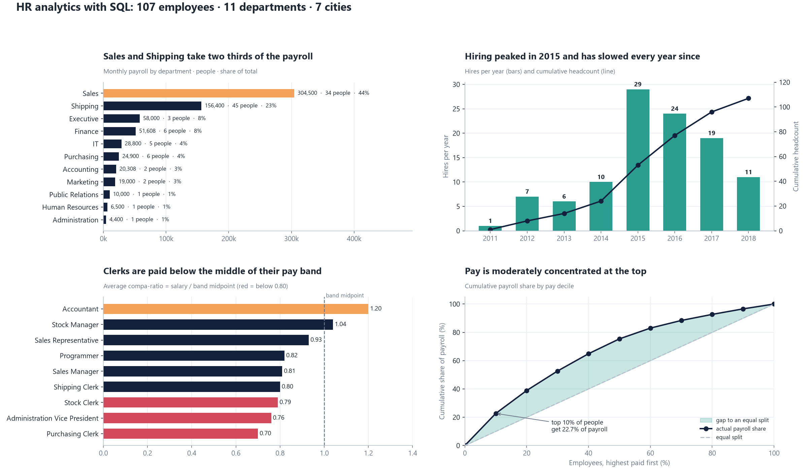
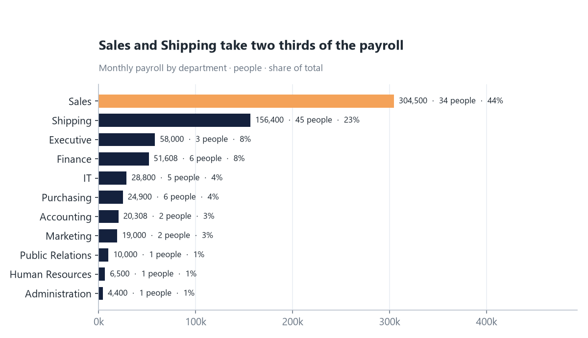
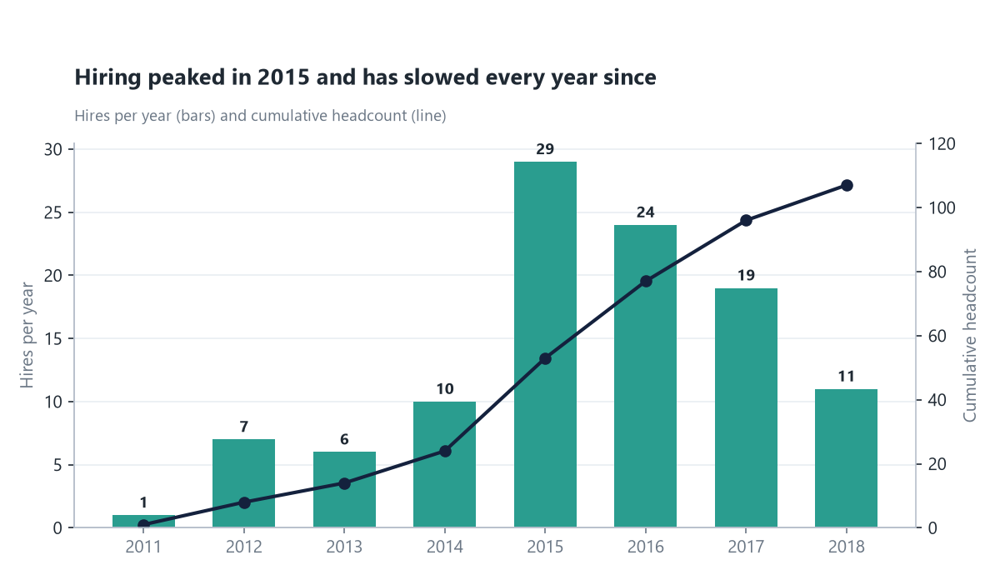
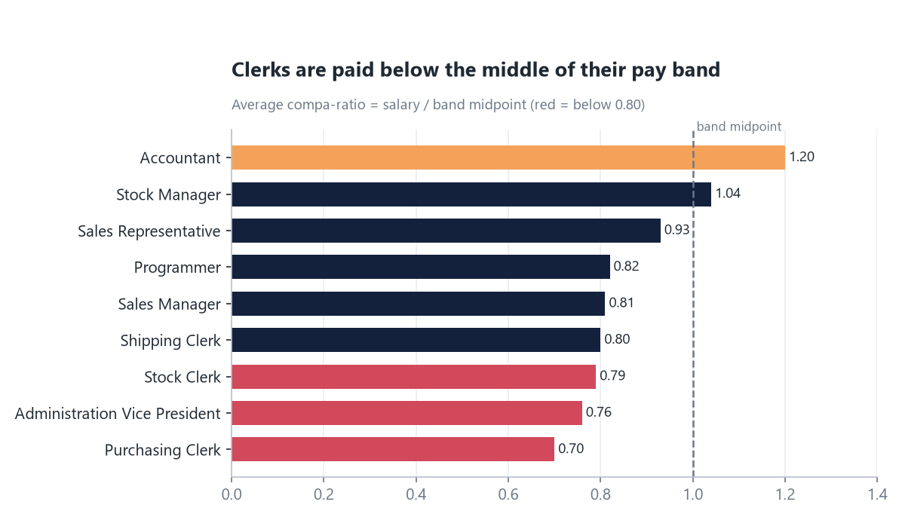
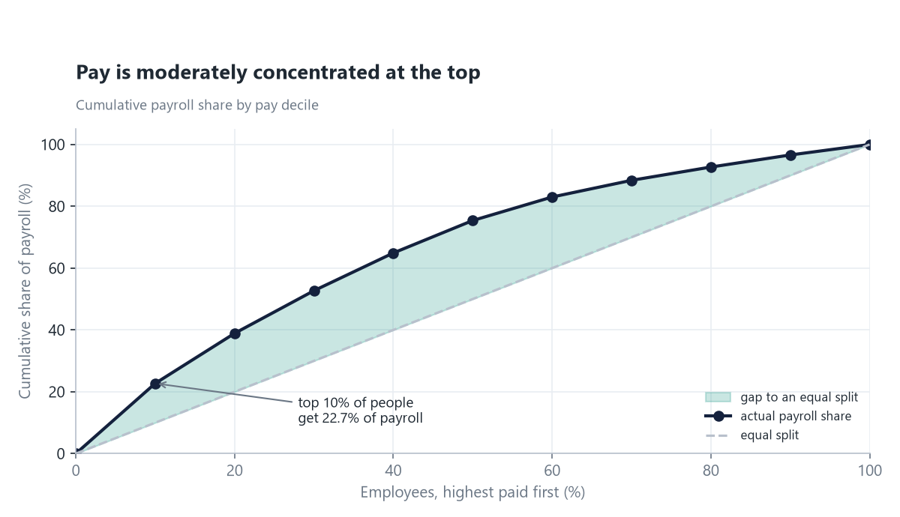

# SQL ilə HR analitikası

> Əmək haqqı, işə qəbul, ədalətli ödəniş və təşkilat strukturu üzrə real HR suallarına cavab verən 32 SQL sorğusu (join, subquery, CTE, rekursiv CTE, window funksiyaları). SQLite ilə işləyir, heç nə quraşdırmaq lazım deyil.

[English](README.md)



## Biznes suallar

1. Əmək haqqı fondu hara gedir və nə qədər cəmlənib?
2. İşə qəbul zamanla necə dəyişib?
3. Ödəniş vəzifənin maaş diapazonuna nisbətən ədalətlidirmi (compa-ratio)? Maaş sıxılması varmı?
4. Təşkilat necə qurulub (dərinlik, idarəetmə əhatəsi, coğrafiya)?
5. Komissiya satış maaş fonduna nə qədər əlavə edir?

## Əsas nəticələr

| Tapıntı | Rəqəm |
|---|---|
| İşçi sayı / aylıq maaş fondu | 107 / 691,416 |
| Satış şöbəsinin payı | 44.5% (34 nəfər, orta maaş 8,956, hamısı komissiyadadır) |
| Satış + Daşınma payı | təxminən 67% |
| Ən yüksək maaşlı 10% | fondun 22.7%-ni alır (ilk 30%: 52.7%) |
| İşə qəbul zirvəsi | 2015-də 29 nəfər, sonra 24, 19, 11 (davamlı azalma) |
| Maaş diapazonunun ortasının 80%-dən aşağı | Purchasing Clerk 0.70, Stock Clerk 0.79, Shipping Clerk 0.80 |
| Mühasiblər | 1.20, diapazonuna nisbətən ən yaxşı ödənilən vəzifə |
| Komissiyanın əlavəsi | Satış nümayəndələri +22.2%, Satış menecerləri +30.6% |
| Maaş sıxılması | Ən yeni proqramçı (6,000) ən köhnə proqramçıdan (4,800) 1,200 çox alır |
| Staj və maaş | 2 ildən az: orta 4,840; 2-4 il: 6,850; 4-6 il: 8,668 |
| Təşkilat | 4 səviyyə; CEO-nun 14 birbaşa tabeçisi var; 106 işçidən 37-si (34.9%) öz rəhbərindən əvvəl işə qəbul olunub |
| Coğrafiya | ABŞ 68 işçi, Böyük Britaniya 35, Kanada 2, Almaniya 1; 27 şöbədən 16-sında işçi yoxdur |
| Maaş diapazonuna uyğunluq | heç kim öz vəzifəsinin min/maks həddindən kənarda ödənilmir (q16 sıfır sətir qaytarır) |

Staj hesablamalarında baza tarix datadakı ən son işə qəbul tarixidir (2018-04-21), nəticələr təkrarlanandır.

## Qrafiklər

| | |
|---|---|
|  |  |
|  |  |

## Data modeli

7 cədvəl: regions (4 sətir), countries (25), locations (23), departments (27), jobs (19), employees (107), job_history (10). Əlaqə sxemi [ingiliscə README-də](README.md#data-model), tam DDL (açarlar, CHECK, indekslər): [sql/00_schema.sql](sql/00_schema.sql).

## Sorğu kataloqu

| Fayl | Sorğular | Mövzular |
|---|---|---|
| [01_basics.sql](sql/01_basics.sql) | q01-q05 | filtr, sıralama, NULL, LIKE/IN |
| [02_aggregation.sql](sql/02_aggregation.sql) | q06-q11 | GROUP BY, HAVING, CASE, tarix hissələri |
| [03_joins.sql](sql/03_joins.sql) | q12-q17 | 6 cədvəlli join, LEFT JOIN, anti-join, self join |
| [04_subqueries_cte.sql](sql/04_subqueries_cte.sql) | q18-q22 | korrelyasiyalı subquery, EXISTS, CTE, rekursiv CTE |
| [05_window_functions.sql](sql/05_window_functions.sql) | q23-q27 | DENSE_RANK, AVG OVER, LAG, NTILE, FIRST_VALUE |
| [06_hr_analytics.sql](sql/06_hr_analytics.sql) | q28-q32 | compa-ratio, ümumi gəlir, staj, karyera, şöbə kartı |

Hər sorğunun nəticəsi [results/RESULTS.md](results/RESULTS.md) faylında və CSV kimi `results/` qovluğundadır.

## Necə işlətməli

```bash
pip install -r requirements.txt
python src/build_db.py
python src/run_queries.py
python src/make_charts.py
```

`hr.db` hazır verilir, istənilən SQLite alətində açıb `sql/` fayllarını işlədə bilərsiniz.

## Data haqqında açıq qeydlər

- Data məşhur **Oracle HR nümunə sxemidir** (SQL kursumda istifadə olunub). `employees` cədvəli kurs faylımdandır, kiçik məlumat cədvəlləri standart nümunə datasıdır.
- Kurs nüsxəmdə işə qəbul tarixləri orijinala nisbətən **+10 il** sürüşdürülüb, job_history tarixləri də eyni qaydada.
- Data sintetikdir, real şirkət deyil; nəticələr metodu göstərir.
- `build_db.py` 12 bütövlük yoxlaması aparır, hamısı keçir. Müşahidələr: bir işçinin komissiyası var, lakin Satış şöbəsində deyil; 7 job_history dövrü cari işlə üst-üstə düşür (orijinal nümunənin xüsusiyyəti).

## Müəllif

**Alyaz Cabbarova**, data analitik olmaq istəyən mütəxəssis.
[LinkedIn](https://www.linkedin.com/in/alyaz-cabbarova-450a6140b) · alyazcbbrv@gmail.com · [GitHub](https://github.com/alyazcbbrv-byte)

MIT lisenziyası.
