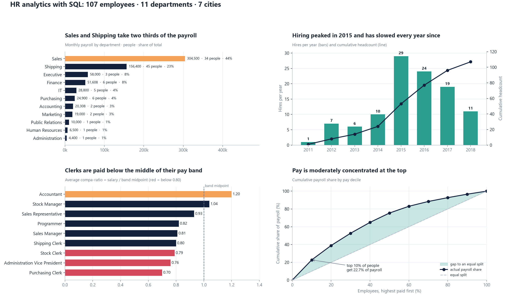
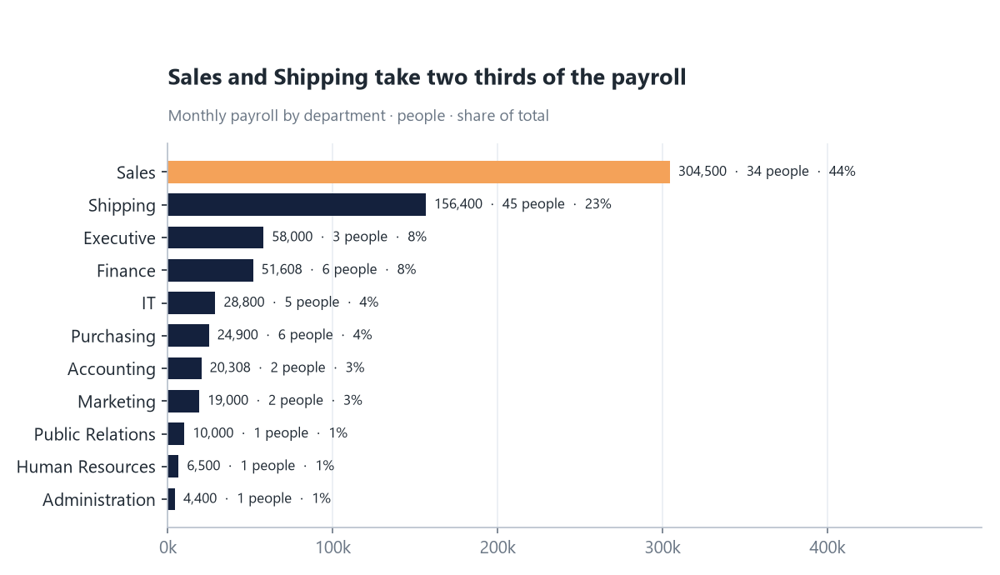
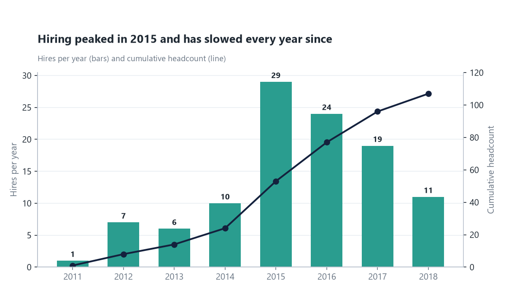
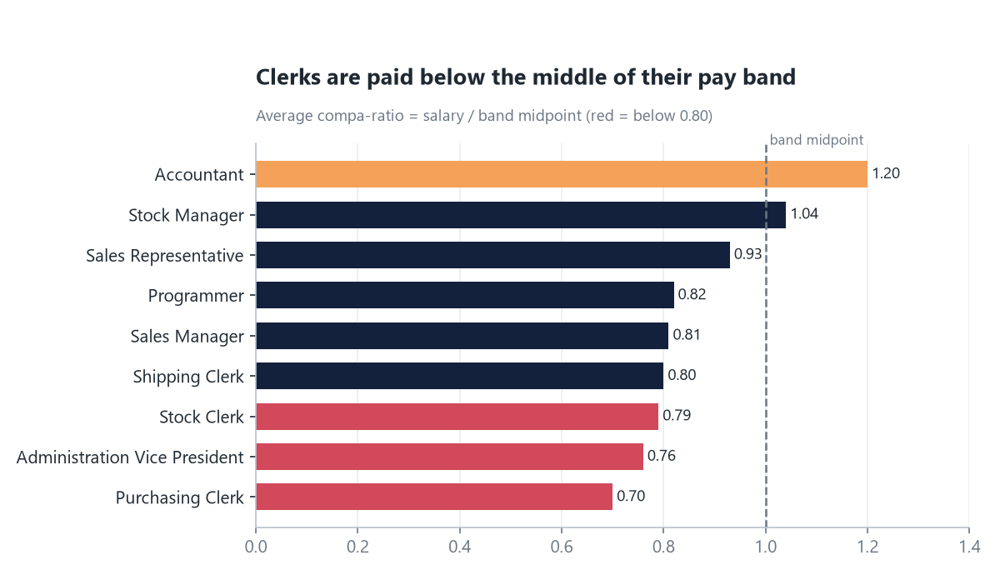
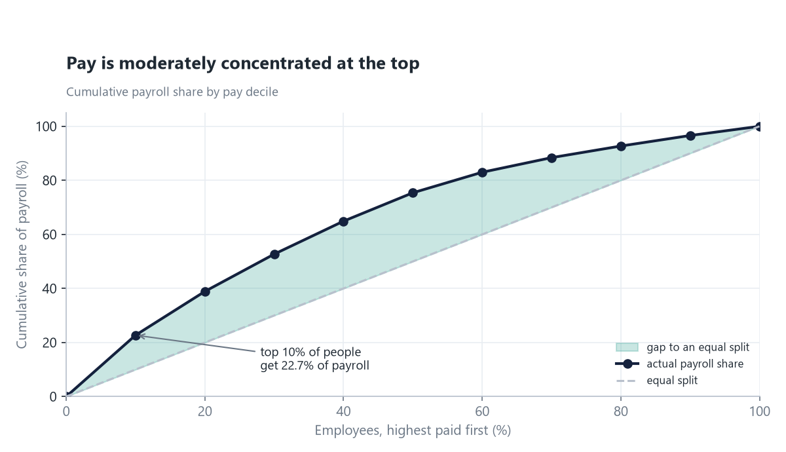
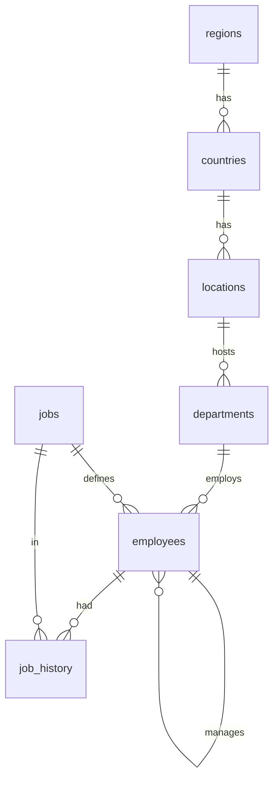

# HR Analytics with SQL

> 32 SQL queries (joins, subqueries, CTEs, recursive CTE, window functions) that answer real HR questions about payroll, hiring, pay fairness and organisation structure. Runs anywhere: SQLite, no installation.

[Azərbaycanca](README.az.md)



## Business questions

1. Where does the payroll go, and how concentrated is it?
2. How has hiring developed over time?
3. Is pay fair relative to each job's pay band (compa-ratio)? Is there salary compression?
4. How is the organisation structured (depth, span of control, geography)?
5. How much do commissions add to the sales payroll?

## Key findings

| Finding | Number |
|---|---|
| Employees / monthly payroll | 107 / 691,416 |
| Sales department share of payroll | 44.5% (34 people, avg salary 8,956, all on commission) |
| Sales + Shipping share of payroll | about 67% |
| Top 10% of earners get | 22.7% of payroll (top 30%: 52.7%) |
| Hiring peak | 29 hires in 2015, then 24, 19, 11 (steady slowdown) |
| Jobs paid below 80% of band midpoint | Purchasing Clerk 0.70, Stock Clerk 0.79 (12 of 20 below 0.80), Shipping Clerk 0.80 (11 of 20) |
| Accountants | 1.20 compa-ratio, the best-paid job relative to its band |
| Commission uplift | Sales Representatives +22.2%, Sales Managers +30.6% on base pay |
| Salary compression | The newest Programmer (6,000) earns 1,200 more than the longest-serving one (4,800) |
| Tenure vs pay | under 2 years: 4,840 avg; 2 to 4 years: 6,850; 4 to 6 years: 8,668 |
| Organisation | 4 levels; CEO has 14 direct reports; 37 of 106 employees (34.9%) were hired before their own manager |
| Geography | USA 68 employees, UK 35, Canada 2, Germany 1; 16 of 27 departments have no staff |
| Pay band compliance | nobody is paid outside the min/max of their job (q16 returns 0 rows) |

Snapshot date for tenure calculations is the latest hire date in the data (2018-04-21), so results are reproducible.

## Charts

| | |
|---|---|
|  |  |
|  |  |

## Data model



7 tables: regions (4 rows), countries (25), locations (23), departments (27), jobs (19), employees (107), job_history (10). Full DDL with primary keys, foreign keys, CHECK constraints and indexes: [sql/00_schema.sql](sql/00_schema.sql).

## Query catalogue

Every query has a `-- question:` header. Full results with the SQL are in [results/RESULTS.md](results/RESULTS.md); each result is also saved as CSV.

| File | Queries | Topics |
|---|---|---|
| [01_basics.sql](sql/01_basics.sql) | q01 to q05 | filtering, sorting, NULL handling, LIKE/IN |
| [02_aggregation.sql](sql/02_aggregation.sql) | q06 to q11 | GROUP BY, HAVING, CASE bands, date parts |
| [03_joins.sql](sql/03_joins.sql) | q12 to q17 | 6-table join, LEFT JOIN, anti-join, self join, integrity check |
| [04_subqueries_cte.sql](sql/04_subqueries_cte.sql) | q18 to q22 | correlated subquery, EXISTS, CTE, recursive CTE |
| [05_window_functions.sql](sql/05_window_functions.sql) | q23 to q27 | DENSE_RANK, AVG OVER, LAG, running total, NTILE, FIRST_VALUE |
| [06_hr_analytics.sql](sql/06_hr_analytics.sql) | q28 to q32 | compa-ratio, total compensation, tenure, career moves, department scorecard |

## How to run

```bash
pip install -r requirements.txt
python src/build_db.py      # builds hr.db from data/*.csv and runs 12 integrity checks written in SQL
python src/run_queries.py   # runs all 32 queries, writes results/
python src/make_charts.py   # draws images/
```

`hr.db` is included, so you can also open it directly in any SQLite client (DB Browser for SQLite, DBeaver, VS Code) and run the files in `sql/`.

## Data provenance and honest notes

- The data is the well-known **Oracle HR sample schema**, as used in my SQL course. The employees table comes from my course workbook; the small reference tables (regions, countries, locations, departments, jobs, job_history) are the standard sample data, loaded by `src/prepare_data.py`.
- In my course copy the hire dates are shifted **+10 years** compared with the original sample; job_history dates are shifted the same way for consistency.
- The data is synthetic sample data, not a real company. Conclusions illustrate the method; they are not claims about any real organisation.
- Data observations (not integrity errors), reported by `build_db.py`: one employee has a commission but no Sales department (no department assigned), and 7 job_history periods overlap current employment (a quirk of the original sample).
- The circular reference `departments.manager_id` to `employees` is intentionally not enforced by a foreign key; it is verified by a SQL check instead.
- Oracle to SQLite: `TRUNC`, `MONTHS_BETWEEN`, `TO_CHAR` are replaced by `strftime` and `julianday`. Everything else is ANSI SQL and ports easily to PostgreSQL or SQL Server.

## Skills demonstrated

Relational modelling, DDL and constraints, multi-table joins, aggregation, subqueries, CTEs and recursion, window functions, data quality checks in SQL, business interpretation, reproducible Python tooling, data visualisation.

## Author

**Alyaz Cabbarova**, aspiring data analyst.
[LinkedIn](https://www.linkedin.com/in/alyaz-cabbarova-450a6140b) · alyazcbbrv@gmail.com · [GitHub](https://github.com/alyazcbbrv-byte)

Licensed under the MIT License.
